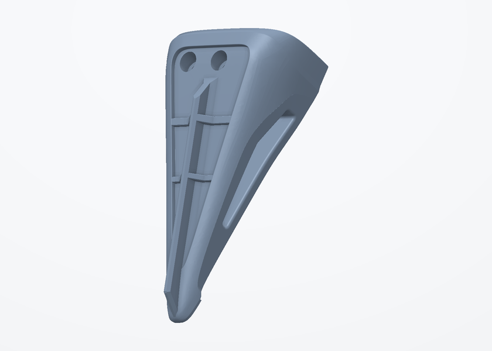

# G1Z 夹指 3D 打印件 / G1Z Gripper Fingers for 3D Printing

适用于配置 G1Z 夹爪的 A1Z 和 LEMO。For A1Z and LEMO equipped with G1Z grippers. [A1Z](https://github.com/userguide-galaxea/galaxea_a1z#urdf-and-cad) · [LEMO](https://github.com/userguide-galaxea/galaxea_lemo#urdf-and-cad)

| 版本 / Version | STEP 模型 / Model | 外观预览 / Preview |
| --- | --- | --- |
| 标准版 / Standard | [`G1Z_Gripper_Finger_3D_Print.stp`](G1Z_Gripper_Finger_3D_Print.stp) |  |
| 加强筋版 / Reinforced with ribs | [`G1Z_Gripper_Finger_3D_Print_Reinforced.stp`](G1Z_Gripper_Finger_3D_Print_Reinforced.stp) |  |
