# Galxea CAD Files

## 中文

本仓库存放星海图机器人相关 CAD 文件（STEP/STP 等格式），例如相机支架、机械臂 base、法兰结构等，供客户集成、工装与二次开发使用；部分零件同时提供标注尺寸的工程图纸。

| 目录 | 内容 |
|:---|:---|
| [`A1X/`](A1X/README.md), [`A2/`](A2/README.md), [`G1/`](G1/README.md) | A1X, A2 机械臂末端连杆、G1夹爪零件与法兰结构 |
| [`A1Z/`](A1Z/README.md) | A1Z 的基座、腕部相机支架、J6 输出法兰模型与工程图纸 |
| [`LEMO/`](LEMO/README.md) | 头部相机完整立杆及立杆上端的 STEP 模型与 PDF 图纸 |
| [`Wrist Camera Holder/`](Wrist%20Camera%20Holder/README.md) | D405 / D435i / GMSL 腕部相机支架 |
| [`tabletop_teleoperation/`](tabletop_teleoperation/README.md) | 桌面遥操作支架与夹爪 |

---

## English

This repository hosts CAD files for Galaxea robots, including camera mounts, robotic arm bases, and flange structures. Models are provided in STEP/STP format, with dimensioned engineering drawings for selected parts.

| Directory | Description |
|:---|:---|
| [`A1X/`](A1X/README.md), [`A2/`](A2/README.md), [`G1/`](G1/README.md) | A1X, A2 robotic arm end links, gripper parts, and flange structures |
| [`A1Z/`](A1Z/README.md) | Base, wrist camera mount, and J6 output flange models and drawings for A1Z |
| [`LEMO/`](LEMO/README.md) | STEP models and PDF drawings for the complete head camera mast and its upper section |
| [`Wrist Camera Holder/`](Wrist%20Camera%20Holder/README.md) | Wrist camera mounts for D405, D435i, and GMSL cameras |
| [`tabletop_teleoperation/`](tabletop_teleoperation/README.md) | Mounting brackets and gripper for the tabletop teleoperation setup |

## STEP previews

| Directory / 目录                                             | STEP / STP                                                                                        | Preview / 外观预览                                                                                                                                                                                                            |
| ---------------------------------------------------------- | ------------------------------------------------------------------------------------------------- | ------------------------------------------------------------------------------------------------------------------------------------------------------------------------------------------------------------------------- |
| [A1X](A1X/README.md)                                       | [`A1X_J6_end.STEP`](A1X/A1X_J6_end.STEP)                                                          | <a href="A1X/previews/a1x_j6_end.png">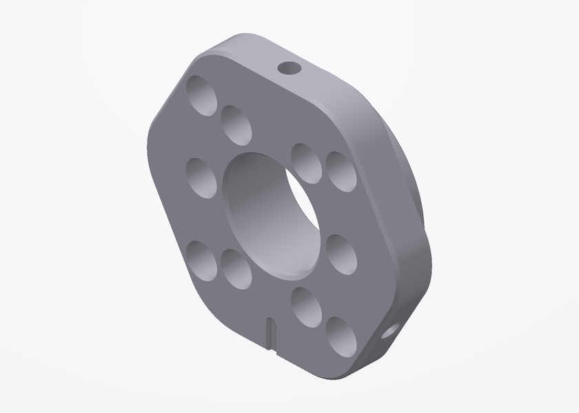</a>                                                                                                   |
| [A1X](A1X/README.md)                                       | [`G1_end.STEP`](A1X/G1_end.STEP)                                                                  | <a href="A1X/previews/g1_end.png">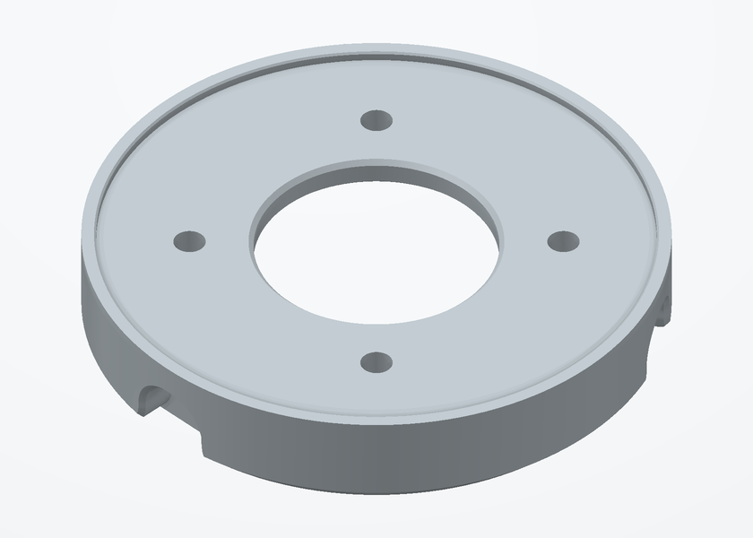</a>                                                                                                               |
| [A1Z](A1Z/README.md)                                       | [`A1Z_Base.STEP`](A1Z/A1Z_Base.STEP)                                                              | <a href="A1Z/previews/a1z_base.png">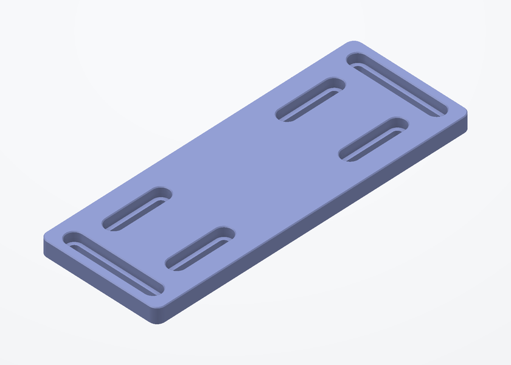</a>                                                                                                         |
| [A1Z](A1Z/README.md)                                       | [`A1Z_J6_Output_Flange.STEP`](A1Z/A1Z_J6_Output_Flange.STEP)                                      | <a href="A1Z/previews/a1z_j6_output_flange.png">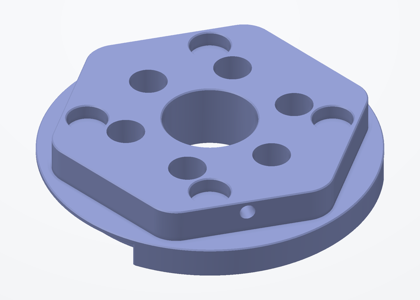</a>                                                                     |
| [A1Z](A1Z/README.md)                                       | [`A1Z_Wrist_Camera_Mount.stp`](A1Z/A1Z_Wrist_Camera_Mount.stp)                                    | <a href="A1Z/previews/a1z_wrist_camera_mount.png">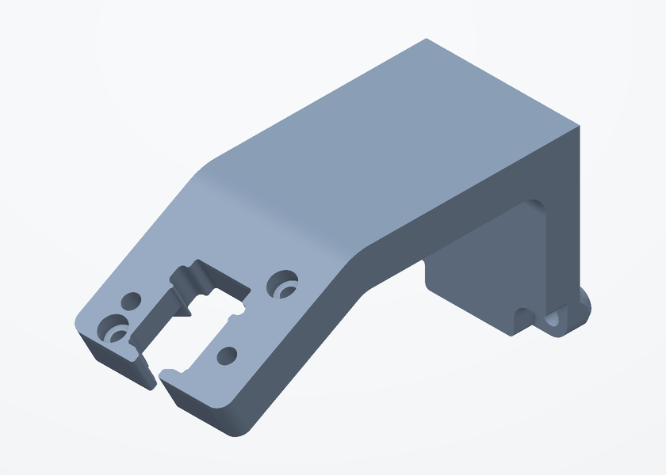</a>                                                               |
| [A2](A2/README.md)                                         | [`Arm_A2_J7_end_V2.STEP`](A2/Arm_A2_J7_end_V2.STEP)                                               | <a href="A2/previews/arm_a2_j7_end_v2.png">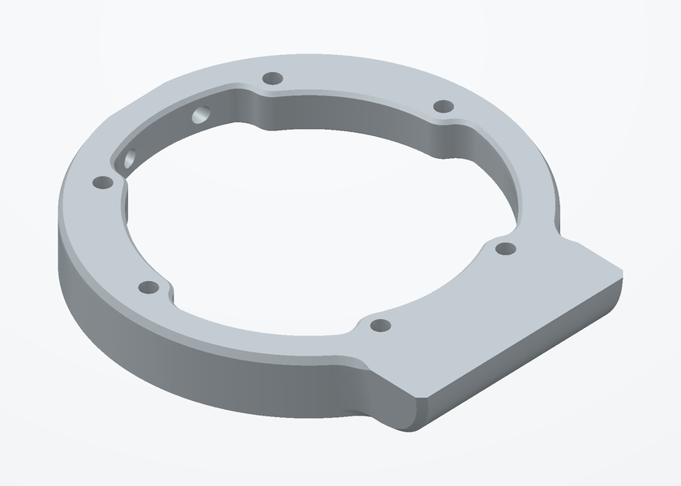</a>                                                                                   |
| [G1](G1/README.md)                                         | [`A2_G1_flange.STEP`](G1/A2_G1_flange.STEP)                                                       | <a href="G1/previews/a2_g1_flange.png">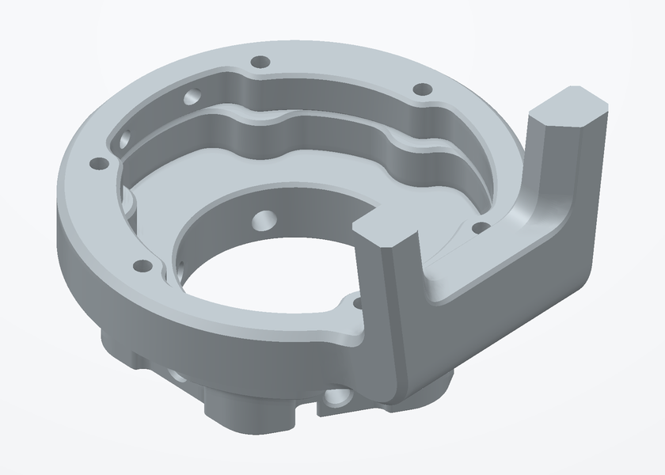</a>                                                                                               |
| [G1](G1/README.md)                                         | [`G1_end.STEP`](G1/G1_end.STEP)                                                                   |                                                                                                                  |
| [G1](G1/README.md)                                         | [`G1_wrist D435i_holder.stp`](G1/G1_wrist%20D435i_holder.stp)                                     | <a href="G1/previews/g1_wrist_d435i_holder.png">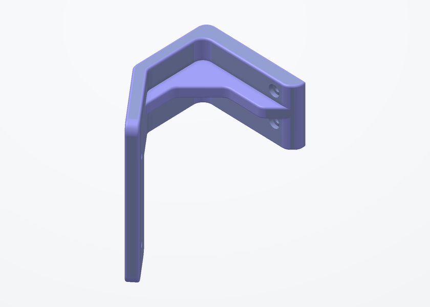</a>                                                                    |
| [G1](G1/README.md)                                         | [`Gripper_Finger2.stp`](G1/Gripper_Finger2.stp)                                                   | <a href="G1/previews/gripper_finger2.png">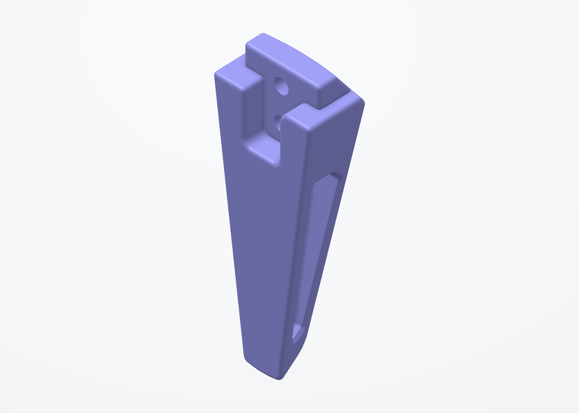</a>                                                                                      |
| [LEMO](LEMO/README.md) | [`LEMO_Head_Camera_Mast.STEP`](LEMO/LEMO_Head_Camera_Mast.STEP) | <a href="LEMO/previews/lemo_head_camera_mast.png">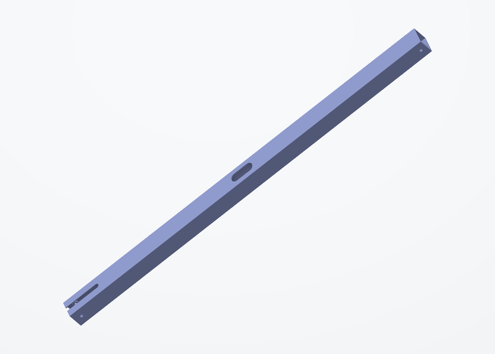</a> |
| [LEMO](LEMO/README.md) | [`LEMO_Head_Camera_Mast_Upper_Section.STEP`](LEMO/LEMO_Head_Camera_Mast_Upper_Section.STEP) | <a href="LEMO/previews/lemo_head_camera_mast_upper_section.png">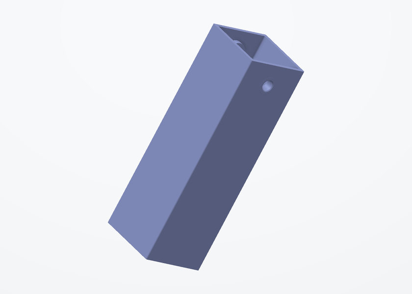</a> |
| [Wrist Camera Holder](Wrist%20Camera%20Holder/README.md)   | [`D405 holder.stp`](Wrist%20Camera%20Holder/D405%20holder.stp)                                    |                                                         |
| [Wrist Camera Holder](Wrist%20Camera%20Holder/README.md)   | [`D435i holder.stp`](Wrist%20Camera%20Holder/D435i%20holder.stp)                                  |                                                      |
| [Wrist Camera Holder](Wrist%20Camera%20Holder/README.md)   | [`GMSL_wrist_camera_holder.stp`](Wrist%20Camera%20Holder/GMSL_wrist_camera_holder.stp)            |                  |
| [tabletop_teleoperation](tabletop_teleoperation/README.md) | [`1_L515_Top_mounting_bracket.stp`](tabletop_teleoperation/1_L515_Top_mounting_bracket.stp)       | <a href="tabletop_teleoperation/previews/1_l515_top_mounting_bracket.png">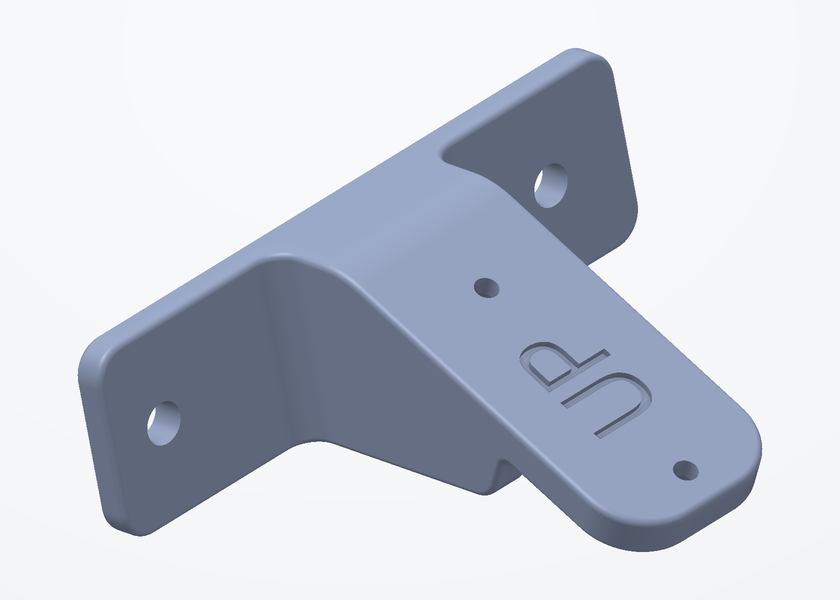</a>          |
| [tabletop_teleoperation](tabletop_teleoperation/README.md) | [`2_L515_Bottom_mounting_bracket.stp`](tabletop_teleoperation/2_L515_Bottom_mounting_bracket.stp) | <a href="tabletop_teleoperation/previews/2_l515_bottom_mounting_bracket.png">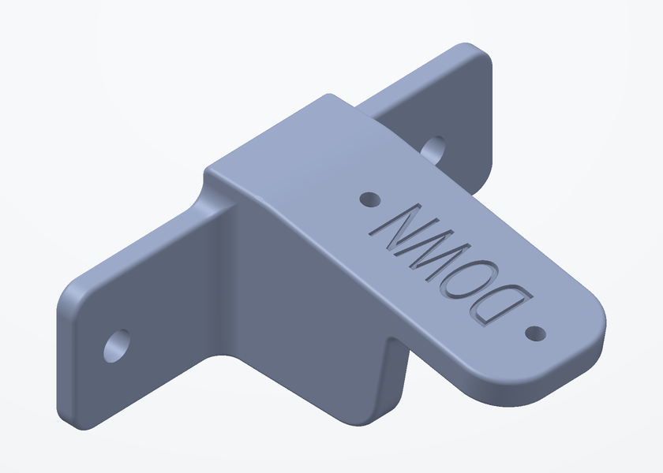</a> |
| [tabletop_teleoperation](tabletop_teleoperation/README.md) | [`3_D435i_mounting_bracket.stp`](tabletop_teleoperation/3_D435i_mounting_bracket.stp)             | <a href="tabletop_teleoperation/previews/3_d435i_mounting_bracket.png">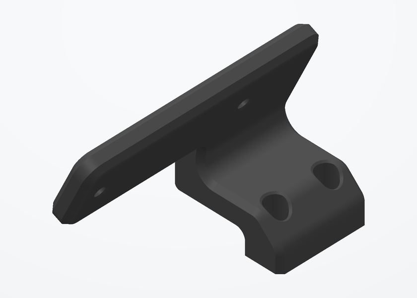</a>                   |
| [tabletop_teleoperation](tabletop_teleoperation/README.md) | [`4_D435i_mounting_bracket.stp`](tabletop_teleoperation/4_D435i_mounting_bracket.stp)             |                    |
| [tabletop_teleoperation](tabletop_teleoperation/README.md) | [`G1_Gen2.stp`](tabletop_teleoperation/G1_Gen2.stp)                                               |                                                                       |
