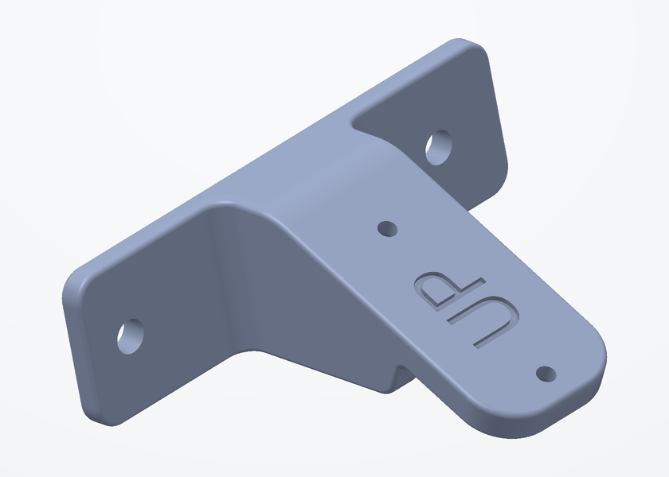
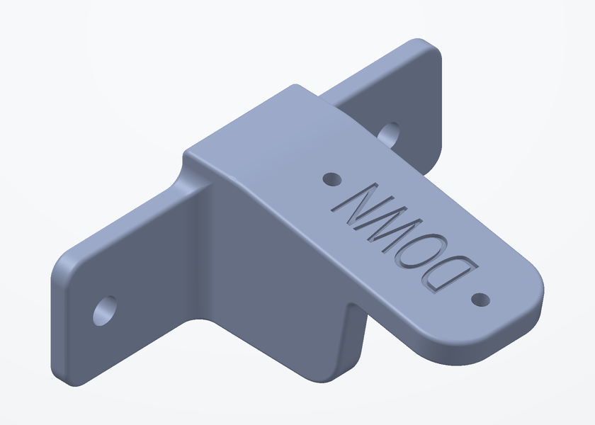
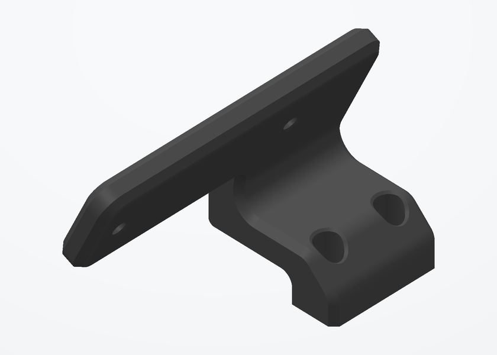
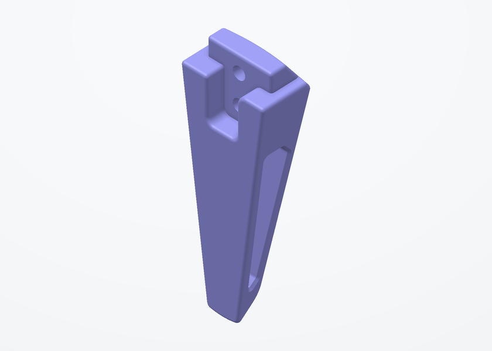

# Tabletop Teleoperation STP
The `STP files` of this repository describes the physical structure of Tabletop Teleoperation.

## STEP previews

The numbered models correspond to the labels in the image above.

| Label | STEP / STP | Preview / 外观预览 |
| --- | --- | --- |
| 1 | [`1_L515_Top_mounting_bracket.stp`](1_L515_Top_mounting_bracket.stp) |  |
| 2 | [`2_L515_Bottom_mounting_bracket.stp`](2_L515_Bottom_mounting_bracket.stp) |  |
| 3 | [`3_D435i_mounting_bracket.stp`](3_D435i_mounting_bracket.stp) |  |
| 4 | [`4_D435i_mounting_bracket.stp`](4_D435i_mounting_bracket.stp) |  |
| — | [`G1_Gen2.stp`](G1_Gen2.stp) |  |
